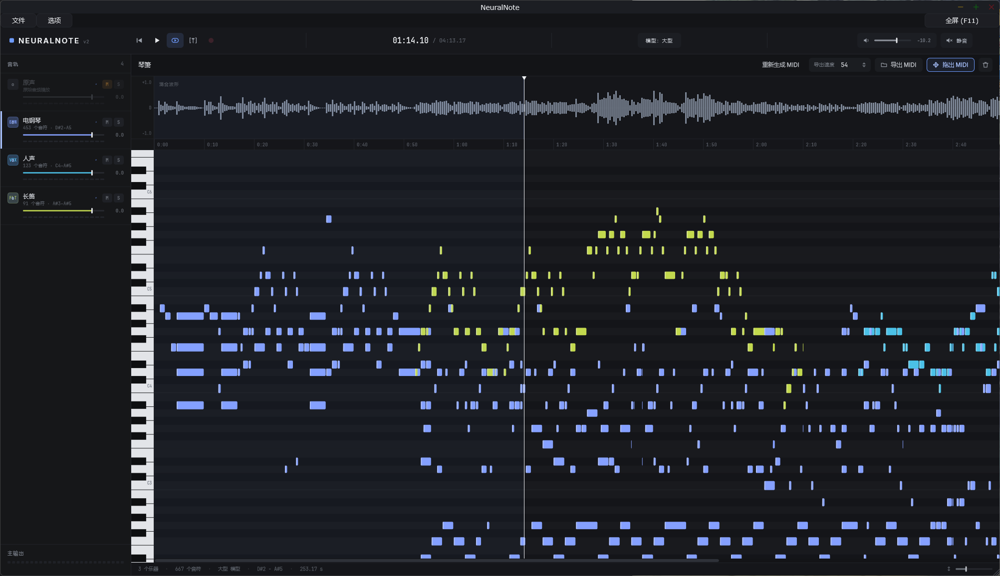
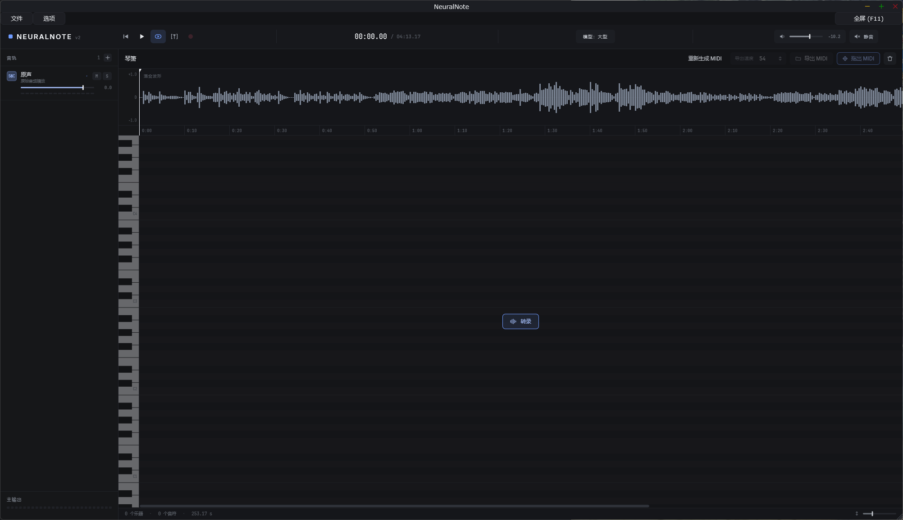
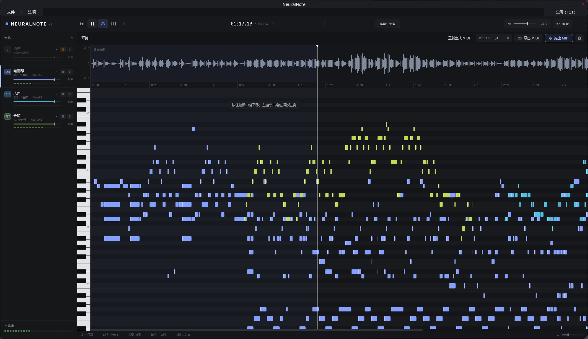

# NeuralNote 中文增强版

**简体中文** · [English](README_EN.md)

把音频转成按乐器分轨的 MIDI，在本地完成转录、试听与导出。

本仓库是 [DamRsn/NeuralNote](https://github.com/DamRsn/NeuralNote) 的社区修改版，由 [cleafw](https://github.com/cleafw) 维护。基于 NeuralNote v2，增加中文界面、乐器多选与分轨导出、原声和乐器独立播放、重新生成 MIDI，以及更适合桌面使用的窗口与菜单操作。模型采用 [MuScriptor](https://github.com/muscriptor/muscriptor)，通过 [muscriptor.cpp](https://github.com/DamRsn/muscriptor.cpp) 在本机运行。

[下载与版本记录](https://github.com/cleafw/NeuralNote/releases) · [反馈问题](https://github.com/cleafw/NeuralNote/issues) · [详细操作说明](docs/USER_WORKFLOW.md) · [Windows GPU 编译说明](docs/WINDOWS_CUSTOM_BUILD.md)



## 功能

- **中文与英文界面**：默认跟随系统语言，支持在“选项 → 语言”切换；未支持的系统语言回退英文。
- **多乐器转录**：音符按乐器显示，可自动识别乐器，或在转录前选择乐器范围。
- **本地处理**：音频转录在电脑上运行；下载模型、检查更新时需要联网。
- **GPU 加速**：当前 Windows 自定义版保留 Vulkan GPU 后端，也可以选择 CPU；已在 RTX 3060 12 GB 上运行验证。
- **独立混音**：原声和各乐器分别控制播放、音量、声相、静音与独奏。
- **按音色试听**：点击乐器行后，左侧琴键使用该乐器音色试听；鼓组按对应键位发声。
- **灵活导出**：导出全部、单个或多个选中乐器；保存为多轨 MIDI，或每个乐器一个 MIDI 文件；可选择写入音量和声相。
- **重新生成 MIDI**：保留原音频，确认替换结果后使用当前模型重新转录。
- **桌面操作**：波形左键拖动定位，钢琴窗中键平移；窗口尺寸与界面缩放分开；独立程序支持最大化和 F11 全屏。

## 下载与平台状态

请从**本仓库的 [Releases](https://github.com/cleafw/NeuralNote/releases)** 获取修改版。原作者网站及原作者的 Releases 提供的是上游版本，可能不包含这里的中文与功能修改。

| 平台 | 当前修改版的状态 |
| --- | --- |
| Windows x64 | 已在本机编译并验证 Vulkan GPU 独立程序；可下载的安装包以本仓库 Releases 附件为准 |
| macOS Apple Silicon / Intel | 项目包含构建流程；当前修改版尚未完成这两个平台的实际运行验证 |
| Linux | 项目支持源码构建；当前修改版尚未完成 Linux 打包与运行验证 |

如果 Releases 中没有对应平台的安装包，可以先按下文从源码编译。**本文不表示各平台安装包均已发布，也不表示 Mac 包已经签名或公证。**

模型不包含在程序中，首次使用需要单独下载。中文与英文使用同一个程序，无需为切换语言重复下载软件。

## 快速开始

1. 打开软件，在“选项 → 音频/MIDI 设置”中选择实际连接耳机或音箱的输出设备。
2. 从顶部模型入口下载模型。下载前会弹出目录选择窗口，确认后下载到该位置，下载完成即可使用，无需解压。
3. 加载音频文件或直接拖入波形区域。支持 WAV、AIFF、FLAC、MP3 和 Ogg Vorbis；也可通过录音获取音频。
4. 选择自动识别或指定待转录乐器，点击“转录”。可以暂停并稍后继续，转录结果会逐步显示。
5. 点击播放，通过侧栏“原声”和各乐器行的播放开关、M（静音）、S（独奏）进行对比试听。
6. 从“文件”菜单或乐器行右键菜单导出 MIDI；也可以把“拖出 MIDI”按钮拖到 DAW 的 MIDI 音轨中。

### 重新生成与播放定位

更换模型后，点击波形上方的“重新生成 MIDI”，或从“文件”菜单、波形右键菜单选择同名选项。已有结果会先询问是否替换；需要保留时，请先导出。原音频会保留，录音或转录过程中不能重复启动。

在波形上按住左键拖动可连续调整播放位置。在钢琴窗内按住中键可上下移动音高视图、左右移动时间视图。按住左侧琴键试听，松开停止。

### 选择与导出乐器

单击乐器行单选，Ctrl 点击增减选择，Shift 点击连续选择，Ctrl+A 全选。轨道选择不改变下一次转录的乐器配置。右键可导出此乐器、所选乐器的多轨 MIDI，或把所选乐器分别导出。静音与独奏控制试听，不决定 MIDI 的导出范围。

更多菜单、会话、声相与导出说明见 [操作说明](docs/USER_WORKFLOW.md)。

## 中文界面截图

<details>
<summary>展开：加载音频，准备转录</summary>



</details>

<details>
<summary>展开：播放与多乐器试听</summary>



</details>

截图由维护者提供，使用本仓库中的相对路径保存，克隆后也可查看。

## 模型与保存位置

| 模型 | 下载大小（约） | 选择参考 |
| --- | --- | --- |
| small | 209 MB | 优先考虑速度与资源占用 |
| medium | 618 MB | 在速度与转录效果之间折中 |
| large | 2.7 GB | 资源需求更高，建议有独立显卡时尝试 |

可以同时下载三个模型，通过顶部模型菜单切换。效果与速度取决于音频、模型和硬件；建议用同一片段试听比较，不保证大模型对每段音频都更好。

下载前可自行选择保存位置；Windows 首次下载优先在可用的非系统本地磁盘准备 `NeuralNote/models`，没有合适磁盘时回退到用户文档等位置。**所选下载目录就是模型使用目录。** 已有自定义路径会保留。

Windows 当前配置保存在 `<用户主目录>/.neuralnote`，日志位于其 `logs/NeuralNote.log`。配置目录与模型目录相互独立，不要把模型复制到配置目录来代替选择模型路径。

模型源为 [DamRsn/muscriptor-gguf](https://huggingface.co/DamRsn/muscriptor-gguf)。手动下载时使用程序支持的 `v1` 文件，保持原文件名与内容，例如 `muscriptor-medium-f16.gguf`。软件更新检查则指向 **cleafw/NeuralNote** 的正式 Releases，推送代码不等于发布新版。

## 从源码编译

```sh
git clone --recurse-submodules https://github.com/cleafw/NeuralNote.git
cd NeuralNote
```

需要 Git、CMake 3.24 或更新版本、支持 C++23 的编译器及 Python 3。首次配置会获取 ggml 和用于试听的音色库源文件，需要联网。漏拉子模块时执行 `git submodule update --init --recursive`。

### Windows GPU 版本

使用 Visual Studio C++ Build Tools、Windows SDK 和 Vulkan SDK。项目提供的维护脚本要求保留 GPU 支持，不会静默降级为仅 CPU 构建。

```powershell
./Tools/build-windows-gpu.ps1 -InteractionTests
# Vulkan SDK 在其他位置时：
./Tools/build-windows-gpu.ps1 -VulkanSdk 'E:\Environment\VulkanSDK\1.4.350.0' -InteractionTests
```

**脚本目前包含维护者本机的 Python、Vulkan SDK 和可选 ggml 缓存路径。其他电脑需先按实际环境调整脚本，不可直接照搬盘符。** 依赖、构建参数与验证方法见 [Windows GPU 编译说明](docs/WINDOWS_CUSTOM_BUILD.md)。

独立程序输出到 `build/NeuralNote_artefacts/Release/Standalone/NeuralNote.exe`。构建产物和模型文件不提交到 Git；面向用户的安装包应放在 Releases。

### macOS 与 Linux

这是供开发者使用的构建入口，仍需安装对应系统的依赖并验证当前修改版：

```sh
cmake -B build -DCMAKE_BUILD_TYPE=Release
cmake --build build --config Release
```

macOS 需要 Xcode 及 Metal 工具链；单次构建对应一种架构，Intel 可指定 `-DCMAKE_OSX_ARCHITECTURES=x86_64`。Linux 需要 [JUCE 的系统依赖](https://github.com/juce-framework/JUCE/blob/master/docs/Linux%20Dependencies.md)，GPU 构建还需 Vulkan 开发工具并配置 `-DMUSCRIPTOR_VULKAN=ON`。本机 Windows 编译成功不代表跨平台验证完成。

## 反馈与贡献

请到 [本仓库 Issues](https://github.com/cleafw/NeuralNote/issues) 反馈，并提供系统、显卡、模型大小、复现步骤及相关日志。欢迎提交 Pull Request。引擎自身的技术文档见 [muscriptor.cpp](https://github.com/DamRsn/muscriptor.cpp)。

## 许可与致谢

NeuralNote 项目代码采用 [Apache-2.0](LICENSE)。第三方库和资源各有许可，完整声明见 [Installers/license.txt](Installers/license.txt) 及各依赖目录。JUCE 框架提供 AGPLv3 与 JUCE 商业许可两种授权路径，发布二进制时需满足所选授权条件，不能把根目录许可证视为所有依赖的许可证。

**MuScriptor 模型权重不采用 Apache-2.0，而是 [CC BY-NC 4.0](https://creativecommons.org/licenses/by-nc/4.0/)，要求署名并限制商业用途。** 软件代码与模型权重的许可应分别理解。Windows 本机自定义构建默认关闭 ASIO；如开启并分发，需遵守相应 Steinberg ASIO 许可。

本修改版保留原作者及贡献者署名：NeuralNote v2 由 [Damien Ronssin](https://github.com/DamRsn) 开发；v1 由 Damien Ronssin 和 [Tibor Vass](https://github.com/tiborvass) 开发，界面由 Perrine Morel 设计。感谢 jatinchowdhury18、trirpi、polygon、SamuMazzi 等上游贡献者，以及 MuScriptor、muscriptor.cpp、JUCE、ggml、TinySoundFont 和音色库项目。上游完整贡献者说明保留在 [English README](README_EN.md#credits) 中。
