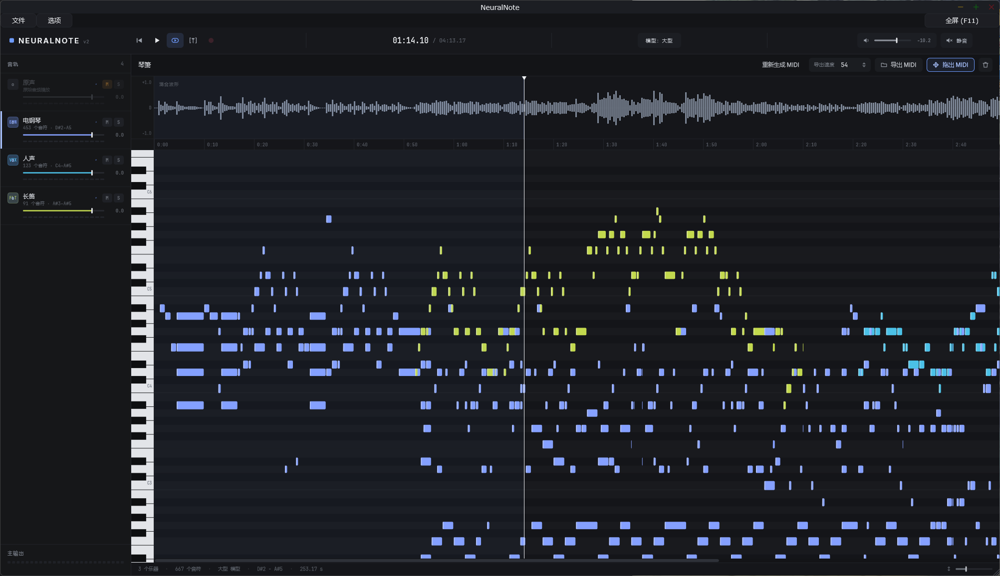
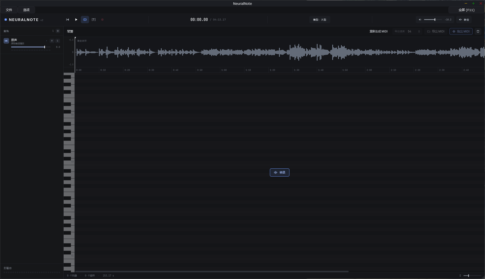
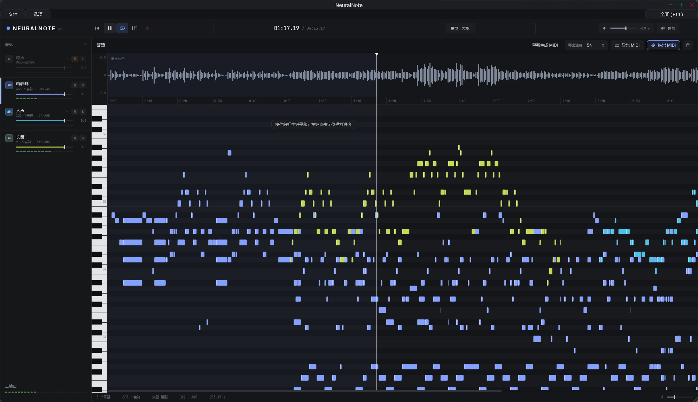

# NeuralNote — community edition

[简体中文](README.md) · **English**

Turn audio into instrument-separated MIDI, with local transcription, playback and export.

This is a community fork of [DamRsn/NeuralNote](https://github.com/DamRsn/NeuralNote), maintained by [cleafw](https://github.com/cleafw). It builds on NeuralNote v2 with Simplified Chinese localization, multitrack selection and export, independent source/instrument playback, MIDI regeneration, and desktop menu and window improvements. It uses [MuScriptor](https://github.com/muscriptor/muscriptor) through [muscriptor.cpp](https://github.com/DamRsn/muscriptor.cpp).

[Downloads and release notes](https://github.com/cleafw/NeuralNote/releases) · [Report an issue](https://github.com/cleafw/NeuralNote/issues) · [Detailed workflow (Chinese)](docs/USER_WORKFLOW.md) · [Windows GPU build notes (Chinese)](docs/WINDOWS_CUSTOM_BUILD.md)



The screenshots show Chinese; select **Options → Language → English** to switch the same application to English. The default follows the system language, falling back to English for unsupported languages.

## Features

- Local, multi-instrument audio-to-MIDI transcription; automatic or explicit instrument selection.
- Vulkan GPU support in the custom Windows build, with CPU also available; tested locally on an RTX 3060 12 GB.
- Independent source and instrument playback, gain, pan, mute, solo and meters.
- Piano-key audition using the last clicked instrument; drum audition follows percussion pitches.
- Single, Ctrl, Shift and Ctrl+A track selection, independent of transcription configuration.
- Export all or selected instruments into a multitrack MIDI, or one MIDI per instrument; optional volume/pan CCs.
- Regenerate MIDI from the same audio with the selected model, after confirming replacement of existing results.
- Left-drag seeking on the waveform, middle-drag piano-roll panning, separate window sizing and UI scaling, and F11 full screen in the standalone application.

## Download and platform status

Use **[this fork's Releases](https://github.com/cleafw/NeuralNote/releases)** for this edition. The upstream website and upstream releases may not include these changes.

| Platform | Status of this fork |
| --- | --- |
| Windows x64 | Vulkan standalone build compiled and tested locally; available installers are listed in Releases |
| macOS Apple Silicon / Intel | Build workflows exist; this fork's changes have not yet been runtime-tested on either architecture |
| Linux | Source build support exists; packaging and runtime testing of this fork are pending |

If no package is attached for your platform, build from source. This document does not imply that all platform packages have been published or that Mac packages are signed/notarized. Models are downloaded separately. Chinese and English use the same application.

## Quick start

1. Choose the physical headphone/speaker output in **Options → Audio/MIDI settings**.
2. Open the model panel and download a model. A folder chooser appears before downloading; that folder is also where the model is loaded from. No extraction is needed.
3. Load or drop WAV, AIFF, FLAC, MP3 or Ogg Vorbis audio, or record audio.
4. Select automatic detection or the instruments to transcribe, then click **Transcribe**. Results appear progressively; pause and resume are supported.
5. Play back the result. Use the source/instrument enable switches, M (mute), S (solo), volume and pan to compare tracks.
6. Export through the File menu or an instrument's context menu, or drag **Drag MIDI out** onto a MIDI track in your DAW.

### Regenerate and navigate

Select a model, then choose **Regenerate MIDI** above the waveform, in the File menu, or in the waveform context menu. Confirm replacement of existing finished/paused results; export them first if you need to keep them. The source audio stays loaded. Regeneration is disabled while recording or transcribing.

Left-drag on the waveform to seek continuously; release to stop seeking. Middle-drag in the piano roll to pan time and pitch. Hold a piano key to audition the current instrument and release to stop.

### Select and export tracks

Click for a single selection, Ctrl-click to toggle, Shift-click for a range, and Ctrl+A to select all. The context menu exports one instrument, the selected instruments in separate MIDI tracks, or one file per selected instrument. Mute and solo affect playback, not export scope. See the [detailed workflow](docs/USER_WORKFLOW.md) for session and MIDI options.

## Screenshots

<details>
<summary>Loaded audio, ready to transcribe</summary>



</details>

<details>
<summary>Multitrack playback and meters</summary>



</details>

## Models and storage

| Model | Approximate download | Trade-off |
| --- | --- | --- |
| small | 209 MB | Lower resource use; prioritize speed |
| medium | 618 MB | Balance speed and transcription quality |
| large | 2.7 GB | Higher resource use; a dedicated GPU is recommended |

All three can be installed and switched through the model menu. Performance and quality depend on the source, model and hardware; compare the same passage rather than assuming the largest is always best.

Choose a folder before downloading. On Windows, a fresh download prefers a suitable non-system local drive with a `NeuralNote/models` folder, falling back to user Documents or another writable location. Existing custom locations are retained. The download directory is the loading directory.

Windows settings live under `<user home>/.neuralnote`, with logs in `logs/NeuralNote.log`; settings and model directories are independent.

Models come from [DamRsn/muscriptor-gguf](https://huggingface.co/DamRsn/muscriptor-gguf). For manual installation use the supported `v1` files unchanged, keeping names such as `muscriptor-medium-f16.gguf`. Application update checks use **cleafw/NeuralNote** Releases, not upstream. Pushing commits alone does not publish a new version.

## Build from source

Requirements: Git, CMake 3.24+, a C++23 compiler and Python 3. First configuration downloads ggml and the soundfont sources, so internet access is needed.

```sh
git clone --recurse-submodules https://github.com/cleafw/NeuralNote.git
cd NeuralNote
```

If submodules are missing, run `git submodule update --init --recursive`.

### Windows GPU build

Install Visual Studio C++ Build Tools, the Windows SDK and the Vulkan SDK, then use:

```powershell
./Tools/build-windows-gpu.ps1 -InteractionTests
# For another Vulkan SDK location:
./Tools/build-windows-gpu.ps1 -VulkanSdk 'E:\Environment\VulkanSDK\1.4.350.0' -InteractionTests
```

**The script currently contains maintainer-local Python, Vulkan SDK and optional ggml cache paths. Adapt them to your machine first.** GPU support is required for this custom Windows delivery; missing dependencies must not silently produce a CPU-only build. See the [build notes](docs/WINDOWS_CUSTOM_BUILD.md).

The standalone output is `build/NeuralNote_artefacts/Release/Standalone/NeuralNote.exe`. Build products and model files are not committed; downloadable installers belong in Releases.

### macOS and Linux

Install the platform dependencies before using this development build entry point:

```sh
cmake -B build -DCMAKE_BUILD_TYPE=Release
cmake --build build --config Release
```

macOS needs Xcode and its Metal toolchain. Each build targets one architecture; use `-DCMAKE_OSX_ARCHITECTURES=x86_64` for Intel. Linux needs [JUCE's dependencies](https://github.com/juce-framework/JUCE/blob/master/docs/Linux%20Dependencies.md); GPU builds also need Vulkan development tools and `-DMUSCRIPTOR_VULKAN=ON`. This fork still needs platform-specific runtime verification.

## Issues and contributions

Report issues in [this fork](https://github.com/cleafw/NeuralNote/issues), including OS, GPU, model, reproduction steps and relevant logs. Pull requests are welcome. Engine API documentation is in [muscriptor.cpp](https://github.com/DamRsn/muscriptor.cpp).

## License

NeuralNote code is under [Apache-2.0](LICENSE). Dependencies and assets retain their own licenses; see [Installers/license.txt](Installers/license.txt) and each dependency directory. JUCE offers AGPLv3 and commercial JUCE licensing paths; binary distributions must comply with the selected path. The root license does not cover every dependency.

**MuScriptor model weights use [CC BY-NC 4.0](https://creativecommons.org/licenses/by-nc/4.0/), with attribution and noncommercial-use restrictions.** Code and model licenses are separate. The local Windows custom build disables ASIO; enabling and distributing ASIO requires compliance with the applicable Steinberg license.

## Credits

#### NeuralNote v2

Developed by [Damien Ronssin](https://github.com/DamRsn), with AI assistance.

#### NeuralNote v1

Developed by [Damien Ronssin](https://github.com/DamRsn) and [Tibor Vass](https://github.com/tiborvass). The plugin
user interface was designed by Perrine Morel.

Many thanks to the v1 contributors!

- [jatinchowdhury18](https://github.com/jatinchowdhury18): File browser.
- [trirpi](https://github.com/trirpi)
  - More scale options in `SCALE QUANTIZE`.
  - Horizontal zoom for the audio waveform and the piano roll.
- [polygon](https://github.com/polygon) and [SamuMazzi](https://github.com/SamuMazzi): Linux support.
